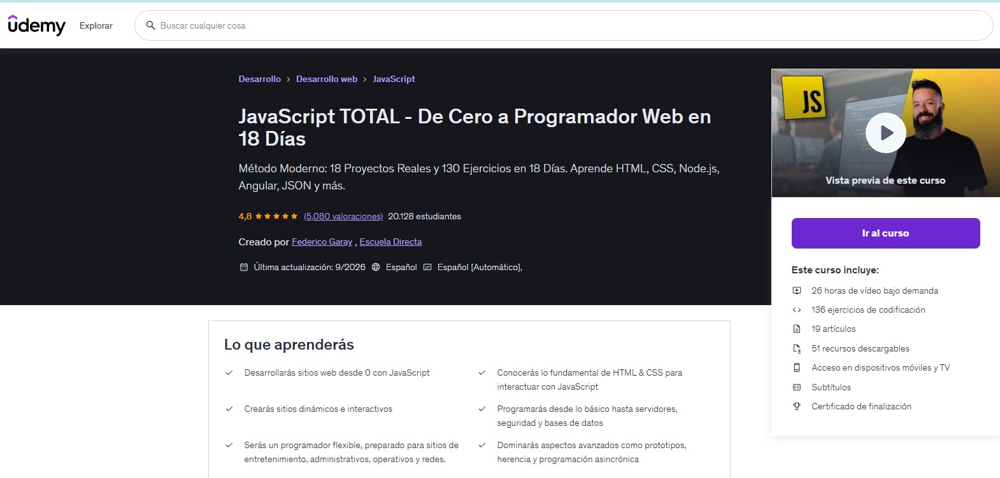
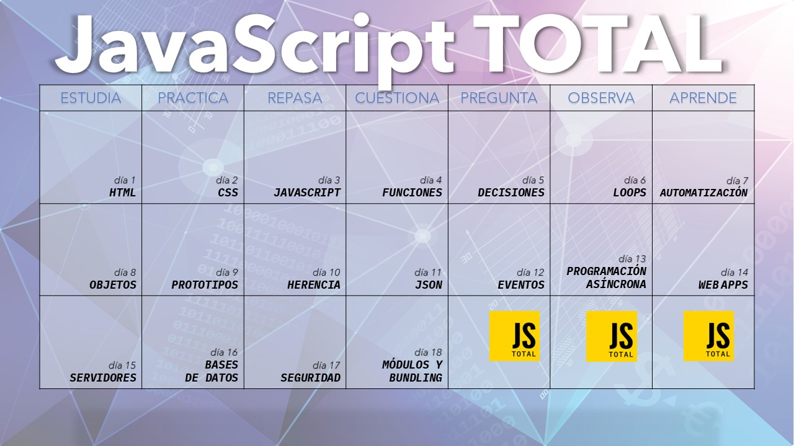

# JavaScript TOTAL - De Cero a Programador Web en 18 Días => Método Moderno: 18 Proyectos Reales y 130 Ejercicios en 18 Días. Aprende HTML, CSS, Node.js, Angular, JSON y más.

Enlace al curso: [JavaScript TOTAL - De Cero a Programador Web en 18 Días](https://www.udemy.com/course/javascript-total/)

Pantallazo del Curso de Udemy: "JavaScript TOTAL - De Cero a Programador Web en 18 Días" 

Aviso: He personalizado mis ejercicios porque yo ya tenía conocimientos previos...

Autora: Paula De Juan Segura 

Profile de la Autora: [https://github.com/PAULADEJUANSEGURA](https://github.com/PAULADEJUANSEGURA)
